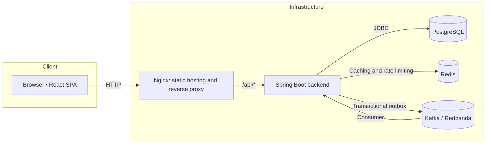

VeritasPay Full-Stack
An enterprise-oriented payment processing and ledger platform built
with Spring Boot and React.

VeritasPay is a full-stack reference implementation demonstrating core
financial-platform concepts, including double-entry accounting,
idempotent payments, role-based access control (RBAC), event-driven
processing, CI/CD, containerisation, and application observability.
Technology Stack
::: {align="center"}

:::Table of Contents
1. Project Overview
2. Related Repositories
3. Features
4. Architecture
5. Technology Stack
6. Repository Structure
7. Getting Started
   - Prerequisites
   - Local Development
   - Running with Docker Compose
8. Available Scripts
9. Backend API Reference
10. Testing
11. Continuous Integration and Docker
    Images
12. Security Considerations
13. Operations and Runbooks
14. Infrastructure Documentation
15. Contributing
16. License
Project Overview
VeritasPay is a reference implementation of a payment processing
platform built around the principles of double-entry bookkeeping.
Each financial transaction generates corresponding debit and credit
entries, maintaining the ledger's accounting invariant:
SUM(DEBIT) == SUM(CREDIT)
The platform consists of:
- Backend: Java 21 and Spring Boot 3.3.5, with PostgreSQL, Redis,
  Apache Kafka, a transactional outbox, and JWT-based role-based
  access control.
- Frontend: React 18 and TypeScript 5, built with Vite and
  Tailwind CSS, with TanStack React Query for server-state management.
- Infrastructure: Docker Compose orchestration for the application
  and supporting services, GitHub Actions CI, and operational
  documentation.
The repository brings together the backend and frontend applications
with the configuration and documentation required to run the full stack
locally.
Related Repositories
  Repository                          Description
  veritas-pay-backend           Spring Boot service providing
ledger, payment, authentication,
outbox, and metrics functionality.

  veritas-pay-frontend          React single-page application for
wallets, transfers, and ledger
activity.
veritas-pay-full              Full-stack repository containing
orchestration, Docker Compose
configuration, CI/CD,
documentation, and release assets.
Features
  Capability              Backend implementation                    Frontend or operational
support
  Double-entry ledger Immutable DEBIT and CREDIT entries,   Searchable Ledger
with a trial-balance endpoint at          Explorer for journal
/ledger/reconciliation/trial-balance.   entries.

  Idempotent            Idempotency-Key header, SHA-256 payload Transfer Simulator with
transfers             fingerprinting, and replay detection      a network-retry
(200 with X-Idempotent-Replayed).     simulation.

  Merchant fee          Automatic 1% fee posting to the           Fee breakdown displayed
processing            FEE_REVENUE account; merchant payments  on payment receipts.
generate a three-line journal entry.      

  Transactional         Publishes events to                       Administrative
outbox                veritas.payment.events after database   inspection through
commit. A consumer updates transaction    /payments/outbox.
state from POSTED to SETTLED.         

  Role-based access     JWT authentication and Spring Security    Role-aware navigation,
control               roles: CUSTOMER, MERCHANT,            backed by server-side
COMPLIANCE_OFFICER, and ADMIN.        authorization checks.

  Rate limiting       Redis-based fixed-window limiter          Applied transparently
configured for 120 requests per minute    to API requests.
per principal or IP.                      

  Observability       Micrometer, Prometheus, OpenTelemetry     Frontend consumes the
bridge, and Swagger UI at                 application API.
/swagger-ui.html.                       

  Automated testing   JUnit 5 and Testcontainers for PostgreSQL Vitest, React Testing
and Kafka integration tests.              Library, and Playwright
end-to-end tests.
CI pipeline         GitHub Actions workflow for builds,       Includes ESLint and
tests, linting, and Docker image          Prettier checks.
publishing.
Architecture

Development and production traffic
- Development: The Vite development server runs on port 5173 and
  proxies /api requests to http://localhost:8080.
- Production-style local deployment: Nginx serves the compiled
  frontend assets from dist/ and proxies /api requests to the
  backend container at backend:8080.
Technology Stack
  Layer                               Technology
  Languages                           Java 21, TypeScript 5

  Backend framework                   Spring Boot 3.3.5 (Web, Security,
Data JPA, Kafka, Actuator)

  Database and migrations             PostgreSQL 16, Flyway

  Caching and rate limiting           Redis 7

  Messaging                           Apache Kafka 3.7 or Redpanda

  Authentication                      JWT (jjwt) and BCrypt

  Observability                       Micrometer, Prometheus,
OpenTelemetry bridge, Swagger UI

  Frontend                            React 18, Vite 5, Tailwind CSS 3

  Server-state management             TanStack React Query

  Testing                             JUnit 5, Testcontainers, Vitest,
React Testing Library, Playwright

  Containerisation                    Docker multi-stage builds, Docker
Compose
Continuous integration              GitHub Actions
Repository Structure
veritas-pay-full/
├── backend/
│   ├── Dockerfile
│   ├── pom.xml
│   └── src/
│       ├── main/java/com/veritaspay/
│       │   ├── account/
│       │   ├── audit/
│       │   ├── auth/
│       │   ├── common/
│       │   ├── config/
│       │   ├── ledger/
│       │   ├── outbox/
│       │   └── payment/
│       └── test/java/com/veritaspay/
├── frontend/
│   ├── Dockerfile
│   ├── nginx.conf
│   ├── package.json
│   ├── vite.config.ts
│   ├── tailwind.config.js
│   └── src/
│       ├── api/client.ts
│       ├── components/
│       ├── context/
│       ├── pages/
│       ├── types/
│       ├── App.tsx
│       └── main.tsx
├── docker-compose.yml
├── .github/
│   └── workflows/
│       └── ci.yml
├── .gitignore
├── README.md
├── LICENSE
└── docs/
    ├── architecture.md
    ├── docker-compose-env.md
    ├── k8s/
    ├── ci-cd.md
    ├── runbook.md
    ├── monitoring.md
    ├── security.md
    ├── configuration.md
    ├── release-process.md
    └── faq.md
Getting Started
Prerequisites
Install the following tools before starting the application locally:

  Dependency                                          Minimum version
  JDK                                                              21
Node.js                                                          20
Docker                                                           24
Docker Compose                                                 2.23
PostgreSQL (when running without Docker)                         16
Redis (when running without Docker)                               7
Kafka or Redpanda (when running without Docker)                 3.7
Note: The Docker Compose setup starts the supporting
infrastructure services for you.

Local Development
Use this option when you want to run the backend and frontend directly
on your machine. Ensure PostgreSQL, Redis, and Kafka or Redpanda are
available and correctly configured.
1. Start the backend
cd backend
./mvnw spring-boot:run
Once the backend has started, the following endpoints are available:
- Swagger UI: http://localhost:8080/swagger-ui.html
- Health check: http://localhost:8080/actuator/health
2. Start the frontend
Open a separate terminal:
cd frontend
npm ci
npm run dev
The Vite development server is available at http://localhost:5173.

The development server proxies /api/* requests to
http://localhost:8080, allowing the frontend to communicate with the
backend without additional local CORS configuration.
Demo accounts
The demo environment uses the shared password VeritasDemo@2026. The
following accounts are referenced by the project:

  Email                        Role
  alice@veritaspay.io        See backend README for assigned role
bob@veritaspay.io          See backend README for assigned role
merchant@apexcloud.io      Merchant
compliance@veritaspay.io   Compliance officer
admin@veritaspay.io        Administrator

Refer to the backend README's Demo Data section for the
authoritative account-to-role mapping.
Security: These credentials are for local demonstration only. Do
not use them in a shared or production environment.

Running with Docker Compose
Docker Compose is the recommended option for starting the complete
application stack.

From the repository root, run:
docker compose up --build -d
The following services will be started:

  Service           Port Purpose
  backend       8080 Backend API
frontend      3000 React application served through Nginx
postgres      5432 Ledger database
redis         6379 Cache and rate-limit storage
kafka        19092 Transactional outbox messaging

Open http://localhost:3000 to access the application.

To stop the services and remove their associated volumes, run:
docker compose down -v
Warning: The -v option removes Docker volumes, including
persisted database data. Back up any data you need before running this
command.

Available Scripts
  Area              Task              Command                                        Description
  Backend           Build and test    ./mvnw clean verify                          Runs unit and
integration tests and
builds the application
JAR.

  Backend           Run locally       ./mvnw spring-boot:run                       Starts the Spring Boot
application.

  Backend           Build Docker      ./mvnw spring-boot:build-image -DskipTests   Builds the
image                                                            veritas-pay-backend
image.

  Frontend          Install           npm ci                                       Installs dependencies
dependencies                                                     from the lockfile.

  Frontend          Development       npm run dev                                  Starts Vite with hot
server                                                           module replacement.

  Frontend          Production build  npm run build                                Generates the
production assets in
dist/.

  Frontend          Preview build     npm run preview                              Serves the production
build locally.

  Frontend          Unit tests        npm test                                     Runs the Vitest test
suite.

  Frontend          End-to-end tests  npm run test:e2e                             Runs Playwright tests;
the backend must be
available.

  Docker Compose    Start services    docker compose up -d                         Starts the configured
services.

  Docker Compose    Stop and remove   docker compose down -v                       Stops services and
volumes                                                          removes associated
volumes.
CI                Workflow          .github/workflows/ci.yml                     Defines linting,
definition                                                       testing, build, and
image-publishing steps.
Backend API Reference
All application API endpoints are grouped under /api/v1.
  Category         Endpoint                                 Method         Authentication /       Description
access                 
  Authentication   /auth/register                         POST           Public                 Registers a user.

  Authentication   /auth/login                            POST           Public                 Returns JWT
accessToken and
refreshToken.

  Authentication   /auth/refresh                          POST           Public                 Refreshes or
rotates the refresh
token.

  Authentication   /auth/me                               GET            Authenticated          Returns the current
user's profile.

  Accounts         /accounts                              GET            Authenticated          Lists accounts
owned by the
current user.

  Accounts         /accounts/directory                    GET            Authenticated          Looks up eligible
transfer
destinations.

  Accounts         /accounts/{id}                         GET            Authenticated          Returns account
details and
balance.

  Accounts         /accounts                              POST           Authenticated          Creates a ledger
account.

  Payments         /payments/top-ups                      POST           Authenticated          Adds funds from the
system treasury.

  Payments         /payments/transfers                    POST           Authenticated          Initiates an
idempotent
transfer; requires
an
Idempotency-Key
header.

  Payments         /payments/outbox                       GET            ADMIN                Lists or inspects
outbox events.

  Ledger           /ledger/transactions                   GET            Authenticated          Returns paginated
journal
transactions.

  Ledger           /ledger/transactions/{txId}            GET            Authenticated          Returns a
transaction and its
entry lines.

  Ledger           /ledger/reconciliation/trial-balance   GET            ADMIN /              Checks that total
COMPLIANCE_OFFICER   debits equal total
credits.

  Audit            /audit/logs                            GET            ADMIN /              Returns the audit
COMPLIANCE_OFFICER   trail for
registrations,
transfers, and
top-ups.

  Health and       /actuator/health                       GET            Public                 Returns application
metrics                                                                                         health information.

  Health and       /actuator/prometheus                   GET            Public                 Exposes metrics for
metrics                                                                                         Prometheus
scraping.
API              /swagger-ui.html                       GET            Public                 Opens the Swagger
documentation                                                                                   UI.
Request headers added by the frontend API client
  Header                              Value or purpose
  Authorization                     Bearer <accessToken>

  X-Correlation-Id                  UUID used for end-to-end request
tracing.
Idempotency-Key                   UUID used to make transfer requests
idempotent; required by
/payments/transfers.
Testing
The project includes unit, integration, and end-to-end tests across the
backend and frontend.
  Test level        Tooling           Location                      Command
  Backend unit      JUnit 5           backend/src/test/java/...   ./mvnw test
tests                                                             

  Backend           Testcontainers    backend/src/test/java/...   ./mvnw verify
integration tests (PostgreSQL and
Kafka)                                          

  Frontend unit     Vitest and React  frontend/src/__tests__/     npm test
tests             Testing Library                                 

  End-to-end tests  Playwright        frontend/e2e/               npm run test:e2e
Continuous        GitHub Actions    .github/workflows/ci.yml    Runs on configured
integration                                                       push and
pull-request events.
Pre-merge verification
Run the following checks before opening or merging a pull request:
# Backend
cd backend
./mvnw clean verify

# Frontend
cd ../frontend
npm ci
npm run lint
npm test -- --run
npm run build
All checks should pass before the changes are merged.
Continuous Integration and Docker Images
The GitHub Actions workflow is defined in .github/workflows/ci.yml. As
configured in the project documentation, the pipeline covers the
following stages:
1. Linting: SpotBugs and Checkstyle for Java; ESLint and Prettier
   for TypeScript.
2. Testing: JUnit, Vitest, and Playwright end-to-end tests.
3. Build: Maven application JAR and multi-stage Docker images for
   veritas-pay-backend and veritas-pay-frontend.
4. Publishing: Publishes Docker images to GitHub Container Registry
   (GHCR), subject to the required GHCR_TOKEN secret and workflow
   configuration.
A CI status badge can be added to the README once the workflow badge URL
is available.
Security Considerations
The following table summarises the security controls and deployment
considerations documented for the project.
  Area                                Current approach and recommendation
  Token storage                       The demo uses localStorage. For
production deployments, use
HttpOnly and Secure cookies for
refresh tokens and implement the
appropriate PKCE flow.

  Authorization                       The frontend adapts navigation to
the user's role. Spring Security
enforces authorization on the
server using controls such as
@PreAuthorize.

  Secrets management                  Avoid putting secrets in VITE_
environment variables because
frontend variables are embedded in
the client bundle. Backend secrets,
including APP_JWT_SECRET,
database passwords, and Kafka
credentials, are supplied through
environment variables.

  Rate limiting                       Redis fixed-window rate limiting is
configured for 120 requests per
minute. The documented fallback is
fail-open when Redis is
unavailable; consider fail-closed
behaviour where stricter
enforcement is required.

  CORS                                The documented configuration allows
http://localhost:5173 for
development or a configured
production domain.

  SQL injection                       Database access uses Spring Data
JPA and prepared statements.

  Cross-site scripting                React escapes rendered output by
default. Any use of
dangerouslySetInnerHTML should be
protected by appropriate
sanitisation.

  Transport security                  Production deployments should run
behind TLS termination, such as a
reverse proxy, cloud load balancer,
or managed certificate service.

  Audit logging                       Sensitive actions are recorded in
the audit_logs table and are
accessible to COMPLIANCE_OFFICER
and ADMIN roles.

  Password storage                    Passwords are hashed using BCrypt
with strength 12.
Dependency maintenance              Dependabot pull requests are used
to help keep GitHub-managed
dependencies up to date.
For the complete hardening checklist, see
[`docs/security.md`](docs/security.md).
Deployment note: The controls above describe the documented
implementation and recommendations. Review configuration, secrets,
access policies, and infrastructure settings before using the platform
in a production environment.

Operations and Runbooks
Common operational commands are listed below.
  Task                                Command
  Start the stack                     docker compose up -d

  Stop the stack and remove volumes   docker compose down -v

  Follow backend logs                 docker compose logs -f backend

  Check backend health                curl http://localhost:8080/actuator/health

  Back up PostgreSQL                  docker exec -t <postgres_container> pg_dump -U veritas veritas_pay > backup.sql

  Restore PostgreSQL                  cat backup.sql \| docker exec -i <postgres_container> psql -U veritas veritas_pay
Scale backend containers            docker compose up -d --scale backend=3
Replace backend in the logs command with another service name to
inspect its logs.

For detailed procedures covering service operations, logging, backup and
restore, and health checks, see [`docs/runbook.md`](docs/runbook.md).
Infrastructure Documentation
The docs/ directory contains supporting architecture, deployment,
security, and operational documentation.
  Document                                                Description
  [`architecture.md`](docs/architecture.md)               System architecture, application
components, and network flows.

  [`docker-compose-env.md`](docs/docker-compose-env.md)   Environment variables used by
Docker Compose, including defaults
and example values.

  [`k8s/README.md`](docs/k8s/README.md)                   Optional Helm and Kubernetes
deployment manifests and guidance.

  [`ci-cd.md`](docs/ci-cd.md)                             GitHub Actions pipeline, artifact
generation, and container image
publishing.

  [`runbook.md`](docs/runbook.md)                         Service start and stop procedures,
log collection, backups, restores,
and health checks.

  [`monitoring.md`](docs/monitoring.md)                   Prometheus endpoints, Grafana
dashboard examples, and Kafka
consumer-lag monitoring.

  [`security.md`](docs/security.md)                       Production hardening guidance for
TLS, cookies, CORS, and secrets
management.

  [`configuration.md`](docs/configuration.md)             Backend, frontend, and Docker
Compose environment-variable
reference.

  [`release-process.md`](docs/release-process.md)         Version tagging, GitHub Releases,
and Docker image publishing.
[`faq.md`](docs/faq.md)                                 Troubleshooting guidance for common
issues, including login errors,
transfer conflicts, and container
startup failures.
Contributing
Contributions are welcome. Please follow the process below when
submitting changes.
1. Fork the repository and clone your fork.
2. Create a feature branch:
   git checkout -b feat/your-feature
3. Implement the change and add or update the relevant unit,
   integration, or UI tests.
4. Run the pre-merge verification checks described in the
   Testing section.
5. Use Conventional Commits for
   commit messages, such as feat:, fix:, docs:, test:, or
   chore:.
6. Push your branch and open a pull request against main.
Before merging, reviewers should verify that:
- CI checks pass, including tests, linting, and Docker builds.
- Relevant project documentation is up to date.
- No credentials or other security-sensitive information are
  committed.
After approval, merging may trigger the configured release workflow to
tag a version and publish Docker images.
License
This project is distributed under the MIT License. See the
LICENSE file for the complete license terms.
Maintainer:
@naveentadi626-oss
